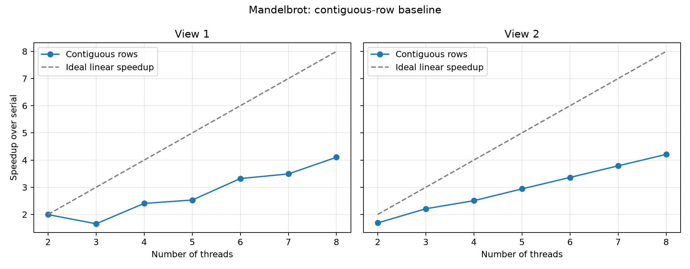

# Mandelbrot: Contiguous-Row Baseline

The contiguous-row implementation produces the same image as the serial reference for both views at every tested thread count from 2 to 8. At eight threads, it achieves **4.10x speedup on View 1** and **4.21x on View 2** in the local WSL environment. This version is the baseline for the next work-distribution experiment.

## Work Distribution

Thread `i`, among `N` threads, computes the half-open row interval:

```text
startRow = height * i / N
endRow   = height * (i + 1) / N
numRows  = endRow - startRow
```

Integer division rounds each boundary down. The first block starts at row zero, adjacent blocks share the same boundary, and the last block ends at `height`. Every row therefore belongs to exactly one block, even when the height is not divisible by the number of threads. Block sizes differ by at most one row.

Each worker calls the existing `mandelbrotSerial()` for its own interval. Reusing the reference computation preserves the pixel arithmetic and viewport mapping. Workers write to separate output regions, and the existing joins ensure that rendering finishes before validation. The function also rejects thread counts outside the supported range of 1 to 32.

## Measurement Method

Measurements were collected on November 2, 2026 (Asia/Shanghai), using an Intel Core i7-14650HX under WSL2. The guest exposes 24 logical CPUs. The build uses GCC 13.3.0 and the existing Makefile flags, including `-O3` and `-std=c++11`. These results describe this local environment rather than the four-core myth machine specified in the assignment.

Each image contains 1600 by 1200 pixels, with at most 256 iterations per pixel. For each view and thread count, the executable measures five serial runs and five threaded runs, then reports the minimum of each group. Configurations run sequentially without CPU affinity pinning. Serial time is measured again for each configuration rather than taken from a single shared reference run.

The threaded interval includes thread creation, computation, and joining. Allocation, clearing the output arrays, writing image files, and checking results occur outside the timed sections. Speedup is calculated as `serial_ms / parallel_ms` from the reported millisecond values; the CSV retains six decimal places for this ratio.

## Results

| Threads | View 1 serial (ms) | View 1 parallel (ms) | View 1 speedup | View 2 serial (ms) | View 2 parallel (ms) | View 2 speedup |
| ---: | ---: | ---: | ---: | ---: | ---: | ---: |
| 2 | 418.781 | 210.045 | 1.99x | 234.343 | 138.874 | 1.69x |
| 3 | 419.141 | 253.136 | 1.66x | 234.084 | 105.945 | 2.21x |
| 4 | 419.504 | 174.341 | 2.41x | 229.717 | 91.655 | 2.51x |
| 5 | 426.324 | 168.570 | 2.53x | 231.915 | 78.888 | 2.94x |
| 6 | 424.416 | 127.832 | 3.32x | 234.354 | 69.715 | 3.36x |
| 7 | 421.065 | 120.640 | 3.49x | 232.943 | 61.511 | 3.79x |
| 8 | 418.329 | 101.940 | 4.10x | 233.200 | 55.408 | 4.21x |



Speedup is not linear. View 1 becomes slower when moving from two threads to three, despite assigning fewer rows to each worker. Equal row counts do not imply equal work: pixels can require different numbers of iterations before escaping. With three contiguous blocks, the central region is assigned to one worker, making load imbalance a plausible explanation for the slowdown. Per-thread timing has not yet been collected, so this remains a hypothesis to test in the next stage. Thread overhead and scheduling can also affect the measurements.

## Correctness Checks

All 14 full-image runs passed the executable's pixel-by-pixel comparison against the serial image and exited with status zero. At height 1200, the seven-thread configuration also exercises a non-divisible partition.

A separate instrumented check replaced the pixel computation with atomic row-visit counters while invoking the actual threading implementation. Across 192 configurations (heights 0, 1, 7, 1199, 1200, and 1201; thread counts 1 through 32), every valid row was visited exactly once and no out-of-range interval was passed to the worker computation. This also checks empty blocks when there are more threads than rows.

## Preserved Artifacts

- [Raw program output](contiguous-output.txt): commands, timings, and exit status for all 14 image runs.
- [Performance data](contiguous-results.csv): serial and parallel times, calculated speedups, and validation results.
- [Environment record](contiguous-environment.txt): timestamp, compiler, CPU information, and the source diff used for this experiment.
- [Benchmark script](benchmark_contiguous.py): collects both views and generates the CSV and plot.
- [Row coverage check](check_contiguous.cpp): verifies exact row coverage independently of pixel values.

The Git tag `prog1-contiguous-baseline` preserves the source, documentation, and measured data together. Future optimization measurements should use separate filenames so these results remain available for comparison. Run the benchmark on this tagged version to reproduce the baseline procedure:

```sh
python3 docs/a1/benchmark_contiguous.py
g++ -std=c++11 -O2 -pthread -Icommon docs/a1/check_contiguous.cpp -o /tmp/cs149-check-contiguous
/tmp/cs149-check-contiguous
```

Rerunning the benchmark replaces the `contiguous-*` measurement artifacts in that checkout. Timing differences are expected across runs and machines.
