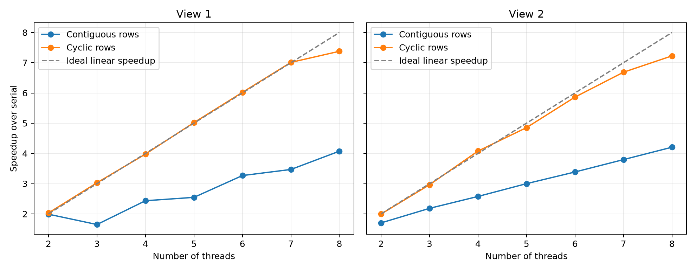

# Mandelbrot: Balancing Work with Cyclic Rows

Distributing rows cyclically achieves **7.38x speedup on View 1** and **7.23x on View 2** with eight threads in the local WSL2 environment. Both meet the assignment's approximate 7–8x target. All 14 full-image configurations passed correctness checks.

## One Static Rule for Every Configuration

Thread `i` computes rows `i`, `i + N`, `i + 2N`, and so on while the row index is below the image height. Each call to the existing `mandelbrotSerial()` computes one complete row.

For example, with three threads:

```text
Thread 0: rows 0, 3, 6, 9, ...
Thread 1: rows 1, 4, 7, 10, ...
Thread 2: rows 2, 5, 8, 11, ...
```

Each row belongs to the thread whose ID equals `row % N`. This gives every row exactly one owner, including when the height is not divisible by the number of threads. Threads beyond the height simply have no rows to compute. The rule does not depend on the view or use a separate configuration for any thread count.

Interleaving rows spreads both bright, expensive regions and dark, inexpensive regions among workers. Unlike contiguous blocks, one worker no longer owns the entire central band. The algorithm does not precompute pixel costs or exchange work between threads.

## Implementation

`workerThreadStart()` now loops over its assigned rows instead of computing one contiguous interval. The pixel algorithm, worker timers, thread creation, and joins remain in place. Each thread writes only its own rows and stores its own timing result. No locks, atomics, queues, barriers, or worker-to-worker communication were added to image computation. The main thread reads timing records after joining all workers.

The timing output in `main.cpp` now describes a first row, exclusive upper bound, and row stride. It remains outside both the worker and overall timing intervals. For cyclic ownership, `start_row=1 end_row=1200 row_stride=3` means rows `1, 4, 7, ...` below 1200, not a contiguous interval.

## Measurement and Correctness

Tests ran on November 2, 2026 (Asia/Shanghai), under WSL2 on an Intel Core i7-14650HX, with 24 logical CPUs exposed to the guest. The existing Makefile uses GCC 13.3.0 and `-O3`. Each image has 1600 by 1200 pixels and at most 256 iterations per pixel. These are local-machine results rather than measurements from the assignment's myth machines.

Both views were tested sequentially with 2 through 8 threads. Each configuration measured five serial and five threaded executions; speedup is the minimum serial time divided by the minimum overall threaded time. Worker comparisons use the measurements from that same fastest overall threaded repetition. All five repetitions are retained in the data. No CPU affinity was set.

All 14 configurations passed the executable's pixel-by-pixel comparison against the serial output. A separate instrumented row-coverage check also passed 192 configurations: heights 0, 1, 7, 1199, 1200, and 1201, each with 1 through 32 threads. Every valid row was visited exactly once. The coverage check uses atomic counters only in its test replacement for pixel computation; the image-rendering implementation does not use them.

## Results

| Threads | View 1 serial (ms) | View 1 parallel (ms) | View 1 speedup | View 2 serial (ms) | View 2 parallel (ms) | View 2 speedup |
| ---: | ---: | ---: | ---: | ---: | ---: | ---: |
| 2 | 430.190 | 211.820 | 2.03x | 238.183 | 119.407 | 1.99x |
| 3 | 421.022 | 138.958 | 3.03x | 237.501 | 80.128 | 2.96x |
| 4 | 417.858 | 105.057 | 3.98x | 240.615 | 59.001 | 4.08x |
| 5 | 419.102 | 83.504 | 5.02x | 234.923 | 48.408 | 4.85x |
| 6 | 417.892 | 69.414 | 6.02x | 234.184 | 39.938 | 5.86x |
| 7 | 416.702 | 59.429 | 7.01x | 234.690 | 35.101 | 6.69x |
| 8 | 415.494 | 56.311 | 7.38x | 233.112 | 32.258 | 7.23x |



Small departures above ideal linear speedup at some thread counts reflect separate serial timing samples, measurement variability, and possible CPU scheduling or frequency differences. They are not evidence that the work was reduced.

## Eight-Thread Comparison

The comparison uses the previous stage's [instrumented contiguous-row measurements](thread-load-analysis.md), so both versions include per-worker timing.

| Metric | View 1 contiguous | View 1 cyclic | View 2 contiguous | View 2 cyclic |
| --- | ---: | ---: | ---: | ---: |
| Overall threaded time (ms) | 101.054 | 56.311 | 56.180 | 32.258 |
| Speedup over each run's serial reference | 4.07x | 7.38x | 4.21x | 7.23x |
| Fastest worker (ms) | 6.072 | 52.801 | 22.816 | 29.452 |
| Slowest worker (ms) | 100.720 | 55.789 | 55.675 | 31.752 |
| Slowest / fastest worker | 16.59 | 1.06 | 2.44 | 1.08 |
| Worker balance | 0.513 | 0.969 | 0.549 | 0.950 |

Relative to the recorded contiguous timings, cyclic assignment reduces eight-thread runtime by factors of **1.79 on View 1** and **1.74 on View 2**. The measurements were collected in separate sessions rather than interleaved trials, so these ratios include normal environmental variation.

Worker balance is `sum(worker_ms) / (N * max(worker_ms))`, a descriptive measure of duration similarity rather than physical CPU utilization. The improvement toward one confirms that expensive work is now shared much more evenly. The remaining timing differences can include small workload variations, scheduling, and frequency effects.

The earlier three-thread bottleneck is also removed: View 1's worker durations now range from **137.805 to 138.582 ms**, compared with **81.109 to 252.830 ms** under contiguous assignment. The corresponding speedup increases from **1.65x to 3.03x**. View 2's three-thread durations range from **79.367 to 80.014 ms**, yielding **2.96x** speedup.

## Preserved Data

- [Raw output](cyclic-output.txt): all commands, timings, and exit statuses.
- [Worker measurements](cyclic-workers.csv): all 350 worker durations, with row strides and matching overall durations.
- [Summary data](cyclic-summary.csv): timings, speedups, selected repetitions, and balance statistics.
- [Environment record](cyclic-environment.txt): compiler, CPU information, and implementation diff.
- [Benchmark script](benchmark_cyclic.py): runs the tests and generates the comparison plot.

The earlier `contiguous-*` and `thread-timing-*` measurement artifacts remain unchanged. The contiguous source is preserved in Git, including the `prog1-contiguous-baseline` tag and the instrumented version at commit `d852bc2`. The cyclic implementation, test data, and report are committed together after review of the test results.

From the repository root, reproduce the cyclic measurements with:

```sh
python3 docs/a1/benchmark_cyclic.py
g++ -std=c++11 -O2 -pthread -Icommon docs/a1/check_contiguous.cpp -o /tmp/cs149-check-cyclic
/tmp/cs149-check-cyclic
```

The existing coverage harness invokes the current worker implementation, so it checks cyclic ownership without changing the renderer. Rerunning the benchmark replaces only the `cyclic-*` artifacts.
