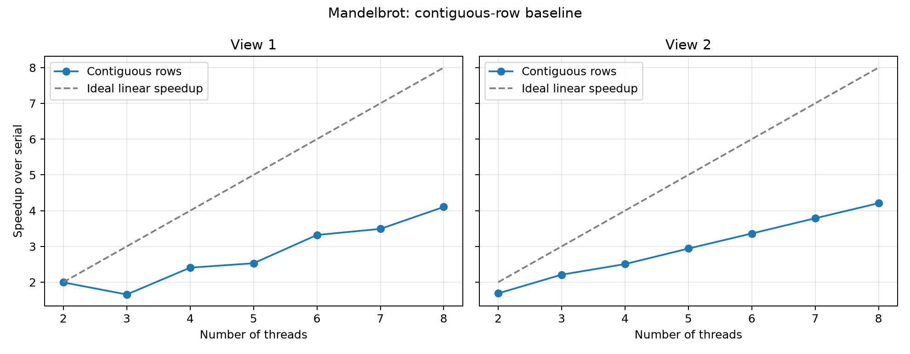
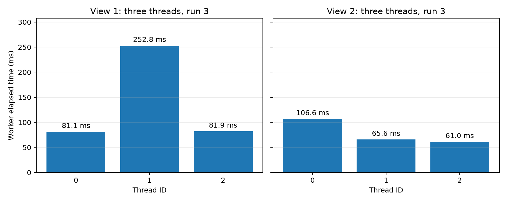
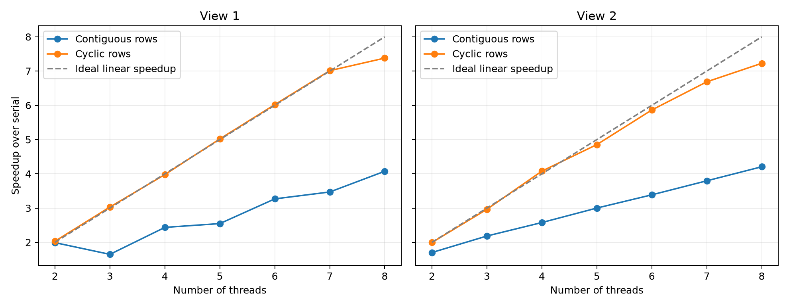
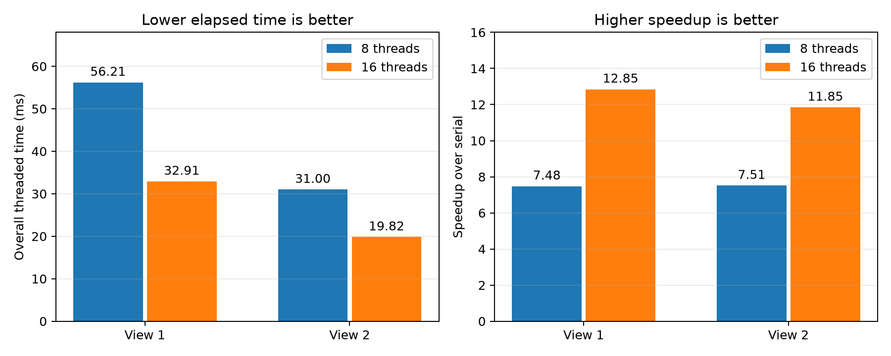

# Program 1: Parallel Mandelbrot Generation

Static cyclic row assignment produces correct images and substantially improves load balance over contiguous blocks. In the final measurement session, eight threads achieve **7.48x speedup on View 1** and **7.51x on View 2**. Sixteen threads further reduce runtime by factors of **1.71** and **1.56**, respectively. These results were obtained on a local Intel Core i7-14650HX under WSL2, rather than the assignment's four-core myth machine.

## Experimental Machine and Method

| Item | Configuration |
| --- | --- |
| CPU model reported by the guest | Intel Core i7-14650HX |
| Physical cores specified for this model | 16: 8 Performance-cores and 8 Efficient-cores |
| Hardware threads specified for this model | 24 |
| Logical processors visible to WSL | 24, numbered 0–23 |
| Guest topology reported by `lscpu` | 1 socket, 12 cores per socket, 2 threads per core |
| Runtime environment | Ubuntu 24.04.3 LTS, x86-64, WSL2 with Microsoft hypervisor |
| Linux kernel | 6.6.87.2-microsoft-standard-WSL2 |
| Compiler | GCC 13.3.0 |
| Build | Existing Makefile: `-O3 -std=c++11 -m64`, linked with pthreads |
| Image and iteration limit | 1600 × 1200 pixels, at most 256 iterations per pixel |

The model's physical core and hardware-thread counts come from [Intel's official specifications](https://www.intel.com/content/www/us/en/products/sku/235996/intel-core-i7-processor-14650hx-30m-cache-up-to-5-20-ghz/specifications.html). WSL exposes a virtual CPU topology: its reported 12 cores with two threads each should not be substituted for the model's 16 physical cores. The host's enabled-core configuration and the placement of individual workers on host cores were not independently inspected.

Measurements were collected on November 2, 2026 (Asia/Shanghai). Each invocation measures five serial and five threaded executions and reports the minimum of each group. Configurations run sequentially without CPU affinity pinning. Speedup is `minimum serial time / minimum overall threaded time`. Serial time is measured separately for each configuration.

The overall threaded interval includes thread creation, computation, joining, and, in the instrumented version, collecting worker durations. Allocation, output clearing, image-file writing, validation, and printing occur outside the timed intervals. Worker durations use the monotonic wall clock in `CycleTimer.h`; they can include scheduling delays. Tables comparing workers use the durations from the same repetition that achieved the minimum overall threaded time, rather than combining different workers' independent minima.

The final 8-versus-16 comparison uses the unchanged optimized implementation at commit `6dc4104`. Both thread counts were measured again in one sequential session. Earlier-stage measurements remain separate so their original evidence is preserved.

## Initial Method: Contiguous Row Blocks

The first implementation assigned the top half to thread 0 and the bottom half to thread 1. It was then generalized so thread `i` among `N` workers owns:

```text
[height * i / N, height * (i + 1) / N)
```

Integer division defines adjacent half-open intervals whose union covers every row exactly once. This handles heights that are not divisible by `N`. Each worker calls the existing `mandelbrotSerial()` for its block, preserving the reference pixel arithmetic and viewport mapping.

The initial contiguous-block measurements were:

| Threads | View 1 speedup | View 2 speedup |
| ---: | ---: | ---: |
| 2 | 1.99x | 1.69x |
| 3 | 1.66x | 2.21x |
| 4 | 2.41x | 2.51x |
| 5 | 2.53x | 2.94x |
| 6 | 3.32x | 3.36x |
| 7 | 3.49x | 3.79x |
| 8 | 4.10x | 4.21x |



Speedup is not linear. View 1 is particularly revealing: three threads perform worse than two, despite each worker receiving fewer rows. Equal pixel counts therefore do not appear sufficient to balance the work.

## Measuring the Bottleneck

Timing was added at the beginning and end of `workerThreadStart()`. Each worker stores its own duration; the main thread prints results only after joining all workers and stopping the overall timer. This avoids printing during computation and preserves measurements from all five repetitions.

With three contiguous blocks, each worker owns 400 rows and 640,000 pixels. The fastest overall repetition for each view gave:

| Thread | Rows (inclusive) | View 1 worker time (ms) | View 2 worker time (ms) |
| ---: | --- | ---: | ---: |
| 0 | 0–399 | 81.109 | 106.617 |
| 1 | 400–799 | 252.830 | 65.640 |
| 2 | 800–1199 | 81.895 | 61.043 |



For View 1, the middle worker takes 3.12 times as long as the fastest worker. Its 252.830 ms closely matches the 253.021 ms overall interval, giving 1.65x speedup over the 416.980 ms serial reference. The two outer workers finish early, leaving the middle worker to determine completion time. By comparison, the two-thread workers take 208.883 ms and 209.826 ms, yielding 1.99x speedup. This directly explains the earlier curve's three-thread dip.

Pixel computation repeats until the complex sequence escapes or reaches the iteration limit. `common/ppm.cpp` maps iteration counts to brightness using a square-root transformation. Brighter pixels indicate more iterations, although brightness is not a linear measure of execution cost. Equal row counts guarantee equal numbers of pixels, not equal computation. The expensive central band in View 1 is concentrated in the middle contiguous block. View 2 places its expensive work differently, making thread 0 the slowest worker in the three-thread case.

At eight threads, contiguous assignment still has substantial imbalance. View 1's worker durations range from 6.072 to 100.720 ms, while View 2's range from 22.816 to 55.675 ms. Increasing thread count divides the expensive region further but also creates workers with little work, limiting the benefit.

## Improved Method: Cyclic Row Assignment

The optimized rule assigns row `r` to thread `r % N`. Equivalently, thread `i` computes rows `i`, `i + N`, `i + 2N`, and so on below the image height. Each worker invokes `mandelbrotSerial()` once per assigned row.

This single static rule works for every supported thread count and both views. Every row has exactly one owner, including non-divisible heights and cases with more threads than rows. Interleaving rows distributes expensive and inexpensive regions among workers instead of giving one worker the entire central band.

Workers write to separate rows and store their own timing results. Rendering introduces no locks, atomics, shared work queues, barriers, or worker-to-worker communication. Thread creation and `join()` are retained; timing results are collected after the joins. Output identifies each worker's first row, exclusive upper bound, and row stride.

The initial optimization experiment produced 7.38x and 7.23x eight-thread speedup for Views 1 and 2. Its measured durations compare with the previous instrumented contiguous version as follows:

| Eight-thread metric | View 1 contiguous | View 1 cyclic | View 2 contiguous | View 2 cyclic |
| --- | ---: | ---: | ---: | ---: |
| Overall time (ms) | 101.054 | 56.311 | 56.180 | 32.258 |
| Speedup over serial | 4.07x | 7.38x | 4.21x | 7.23x |
| Longest / shortest worker duration | 16.59 | 1.06 | 2.44 | 1.08 |



With three threads, cyclic assignment also removes the earlier bottleneck: View 1's durations range from 137.805 to 138.582 ms, giving 3.03x speedup. View 2's durations range from 79.367 to 80.014 ms, giving 2.96x. These results support load imbalance as the primary explanation for the initial three-thread slowdown.

## Final Measurements: Eight and Sixteen Threads

The optimized implementation was measured again with both thread counts, retaining the minimum of five executions per configuration:

| View | Threads | Serial time (ms) | Overall threaded time (ms) | Speedup over serial | Worker time range (ms) |
| ---: | ---: | ---: | ---: | ---: | --- |
| 1 | 8 | 420.473 | 56.207 | **7.48x** | 52.102–56.002 |
| 1 | 16 | 422.815 | 32.910 | **12.85x** | 27.365–32.417 |
| 2 | 8 | 232.907 | 30.997 | **7.51x** | 28.932–30.497 |
| 2 | 16 | 234.794 | 19.819 | **11.85x** | 14.989–19.219 |



Sixteen threads improve runtime noticeably on this machine. Dividing the eight-thread duration by the sixteen-thread duration gives **1.71x additional throughput for View 1** and **1.56x for View 2**, equivalent to runtime reductions of about **41.4%** and **36.1%**. These factors use elapsed times directly, rather than dividing speedups that have separately measured serial references.

The result is consistent with additional execution capacity being available beyond eight workers on this 16-core, 24-thread CPU model. It should not be interpreted using the assignment machine's four-core limit. On the specified four-core, eight-hardware-thread machine, sixteen software threads cannot add physical cores or hardware thread contexts, so similar gains would not be expected solely from doubling software threads.

The gain here is less than twofold. A plausible explanation is the combination of heterogeneous core performance, shared execution resources where hardware threads share a core, thread creation and joining, frequency changes, and host/guest scheduling. These measurements do not record host core placement or hardware counters, so they do not identify each factor's contribution. Worker duration ratios rise from 1.07 to 1.18 for View 1 and from 1.05 to 1.28 for View 2, showing that elapsed-time balance becomes somewhat less uniform with sixteen workers.

The final eight-thread results differ slightly from the first optimization session's 7.38x and 7.23x because both serial and threaded timings were measured again. Both datasets are preserved, and both show approximately 7–8x speedup on the local machine.

## Validation and Supporting Data

The contiguous, instrumented contiguous, and cyclic 2-to-8-thread experiments each passed all 14 full-image configurations. The final four 8/16-thread configurations also passed pixel-by-pixel comparison against the serial result and exited with status zero. The existing row-coverage harness passed 192 configurations with the cyclic implementation, including heights not divisible by thread count and empty worker assignments. Its atomic counters belong only to the test replacement for pixel computation, not the renderer.

| Evidence | Files |
| --- | --- |
| Initial blocks and speedup curves | [Report](contiguous-baseline.md), [CSV](contiguous-results.csv), [raw output](contiguous-output.txt) |
| Contiguous worker timings | [Analysis](thread-load-analysis.md), [all worker records](thread-timing-workers.csv), [summary](thread-timing-summary.csv) |
| Cyclic optimization | [Analysis](cyclic-load-balancing.md), [all worker records](cyclic-workers.csv), [summary](cyclic-summary.csv) |
| Final 8/16-thread tests | [Raw output](final-8-16-output.txt), [all 240 worker records](final-8-16-workers.csv), [summary](final-8-16-summary.csv) |
| Final machine and build record | [Environment](final-8-16-environment.txt) |

The initial contiguous implementation is preserved by `prog1-contiguous-baseline`; the instrumented contiguous implementation is at commit `d852bc2`; the optimized cyclic implementation is at commit `6dc4104`. The final experiment changes no renderer source. Its data and this consolidated report are committed together following the user's approval.

To reproduce the final rendering measurements from `prog1_mandelbrot_threads/`:

```sh
make
./mandelbrot --threads 8 --view 1
./mandelbrot --threads 16 --view 1
./mandelbrot --threads 8 --view 2
./mandelbrot --threads 16 --view 2
```

Every invocation includes its own serial reference, five threaded repetitions, per-worker timings, and image validation. Images use the same output filenames and are overwritten by later invocations; the retained text and CSV files preserve the measurements separately.
