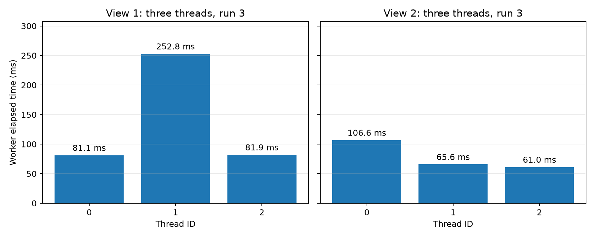

# Mandelbrot: Measuring Thread Load Imbalance

Per-thread timing confirms that contiguous blocks can contain very different amounts of work. For View 1 with three threads, the middle block takes **252.830 ms**, while the top and bottom blocks each take about **81 ms**. The middle worker determines the completion time, explaining why three threads are slower than two in the previous stage's speedup curve.

## Instrumentation and Measurement

`workerThreadStart()` now reads `CycleTimer::currentSeconds()` on entry and immediately after its image computation. The interval includes the small row-boundary calculation and the call to `mandelbrotSerial()`. Each worker stores its duration in its own argument structure. After joining all workers, `mandelbrotThread()` copies these measurements into an optional caller-provided array.

`main.cpp` prints the run number, worker ID, half-open row range, and worker duration only after the overall threaded timer has stopped. No printing occurs within either the worker interval or the overall threaded interval. The overall interval includes launch, joins, timing calls, and copying the measurements. These are elapsed wall-clock times from a monotonic clock, so operating-system scheduling can affect them; they are not measurements of CPU execution time alone.

Both views were measured with 2 through 8 threads on November 2, 2026 (Asia/Shanghai), using the same local WSL2 environment and Makefile as the previous stage: Intel Core i7-14650HX, 24 logical CPUs exposed to the guest, and GCC 13.3.0. Each configuration ran five serial and five threaded repetitions. Configurations ran sequentially without CPU affinity pinning.

The raw files retain all **350 worker durations** across 70 threaded repetitions. The comparisons below use the workers from the single repetition with the lowest overall threaded time in each configuration. This keeps concurrent worker measurements together rather than combining independent per-worker minima. Serial time is the minimum of five serial runs. All 14 configurations passed the built-in full-image comparison against the serial reference.

## Three Threads: Equal Rows, Unequal Work

Each worker receives exactly 400 rows, or 640,000 pixels:

| Thread | Rows (inclusive) | View 1 elapsed (ms) | View 2 elapsed (ms) |
| ---: | --- | ---: | ---: |
| 0 | 0–399 | 81.109 | 106.617 |
| 1 | 400–799 | 252.830 | 65.640 |
| 2 | 800–1199 | 81.895 | 61.043 |

Both selected measurements are repetition 3 of their respective configurations. View 1's slowest worker takes **3.12 times** as long as its fastest. The overall threaded time is **253.021 ms**, close to the middle worker's duration, while the serial time is **416.980 ms**. The resulting speedup is **1.65x**. The sum of the worker durations is about 415.833 ms, but that work is unevenly distributed: the two outer workers finish much earlier and cannot help the middle worker under this static assignment.

View 2 also has unequal work, but its three-thread imbalance is less severe: the slowest-to-fastest ratio is **1.75**. Thread 0 is the bottleneck for this view. Its **106.617 ms** duration closely matches the **106.744 ms** overall time, giving **2.18x** speedup over the **233.101 ms** serial measurement.



## Why Brightness Matters

In `mandelbrotSerial.cpp`, a pixel's calculation repeats until its complex sequence escapes or reaches the limit of 256 iterations. Different pixels therefore require different numbers of iterations. The image writer in `common/ppm.cpp` maps the iteration count to brightness using a square-root transformation: more iterations produce a brighter pixel. Brightness is a useful visual indicator of expensive regions, although it is not a linear scale of execution cost.

Equal row counts guarantee equal pixel counts, not equal iteration counts. In View 1, assigning the middle horizontal band to one worker concentrates the expensive central region in that worker. The timings provide direct evidence that its block requires substantially more elapsed computation time. The different viewport in View 2 changes which band contains the most expensive work, consistent with thread 0 becoming the slowest worker there.

## Explaining the Previous Speedup Curve

The measurements reproduce the main features of the [preserved contiguous-row baseline](contiguous-baseline.md):

| Threads | Previous View 1 speedup | Timed View 1 speedup | View 1 worker max/min | Previous View 2 speedup | Timed View 2 speedup | View 2 worker max/min |
| ---: | ---: | ---: | ---: | ---: | ---: | ---: |
| 2 | 1.99x | 1.99x | 1.00 | 1.69x | 1.70x | 1.39 |
| 3 | 1.66x | 1.65x | 3.12 | 2.21x | 2.18x | 1.75 |
| 4 | 2.41x | 2.44x | 4.09 | 2.51x | 2.58x | 1.91 |
| 5 | 2.53x | 2.55x | 8.37 | 2.94x | 3.00x | 2.12 |
| 6 | 3.32x | 3.27x | 11.81 | 3.36x | 3.39x | 2.35 |
| 7 | 3.49x | 3.47x | 14.74 | 3.79x | 3.80x | 2.56 |
| 8 | 4.10x | 4.07x | 16.59 | 4.21x | 4.21x | 2.44 |

With two threads, View 1's halves take **208.883 ms** and **209.826 ms**, providing nearly balanced work and close to 2x speedup. With three threads, the central block alone takes longer than either half in the two-thread case. Increasing the thread count therefore increases the longest worker duration from about 210 ms to 253 ms, which explains the dip from 1.99x to 1.66x in the previous curve.

At eight threads, View 1's slowest worker still takes **100.720 ms**, compared with **6.072 ms** for its fastest; the overall interval is **101.054 ms**. Adding threads reduces the heaviest block's work but leaves several workers with very little to do. This explains why speedup improves without approaching the ideal eightfold line. The analogous View 2 values are **55.675 ms** for the slowest worker and **56.180 ms** overall, again showing that the slowest block largely determines completion time.

The CSV also reports `worker_balance = sum(worker_ms) / (N * max(worker_ms))`. View 1 scores about **0.998** with two threads and **0.548** with three. A value near one means durations are similar; a smaller value indicates more imbalance. This is a descriptive balance measure, not a hardware CPU-utilization metric. View 1's eight-thread value is **0.513**, consistent with substantial remaining imbalance.

Load imbalance is strongly supported as an explanation for the curve, especially the three-thread dip. The measurements do not isolate every other effect: launch overhead, scheduling, CPU frequency, and the local virtualized environment can also influence the timings. Small differences between the earlier and instrumented runs should not be interpreted as an improvement in the algorithm.

## Data and Reproduction

- [Raw output](thread-timing-output.txt) preserves all commands, durations, and exit statuses.
- [Worker measurements](thread-timing-workers.csv) contains all five repetitions, including row ranges and matching overall durations.
- [Summary data](thread-timing-summary.csv) identifies the selected repetition, speedup, and balance statistics for every configuration.
- [Environment record](thread-timing-environment.txt) preserves the compiler, CPU information, and instrumentation diff.
- [Measurement script](benchmark_thread_timing.py) collects the data and generates the three-thread plot.

From the repository root, run:

```sh
python3 docs/a1/benchmark_thread_timing.py
```

This replaces the `thread-timing-*` artifacts in that checkout. The previous `contiguous-*` measurements and the `prog1-contiguous-baseline` tag remain available for comparison. The row-coverage check also passed all 192 configurations with the instrumented worker implementation.
